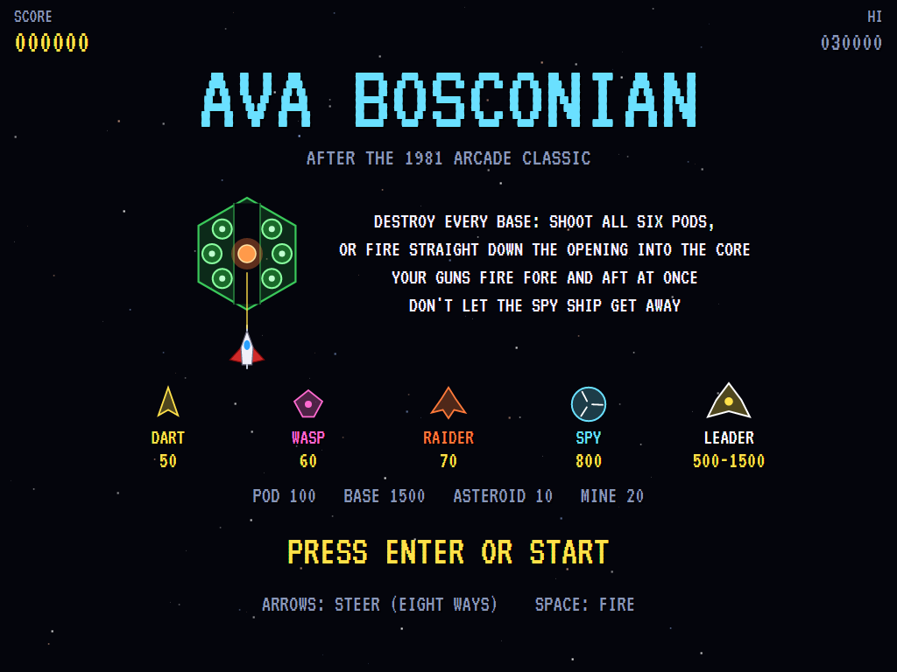
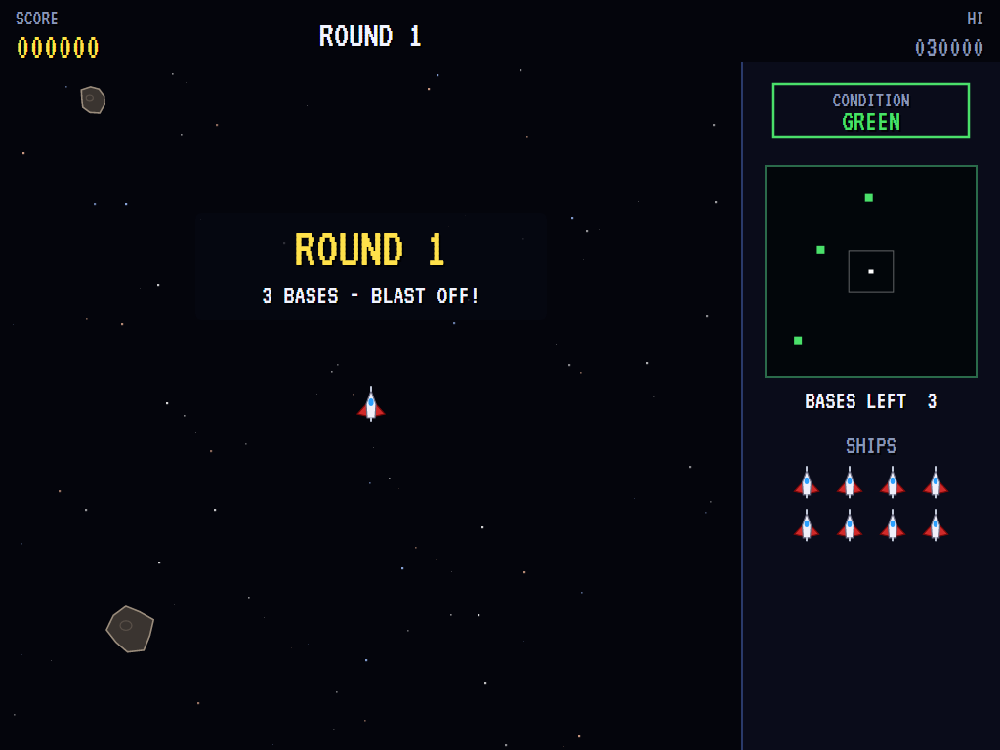
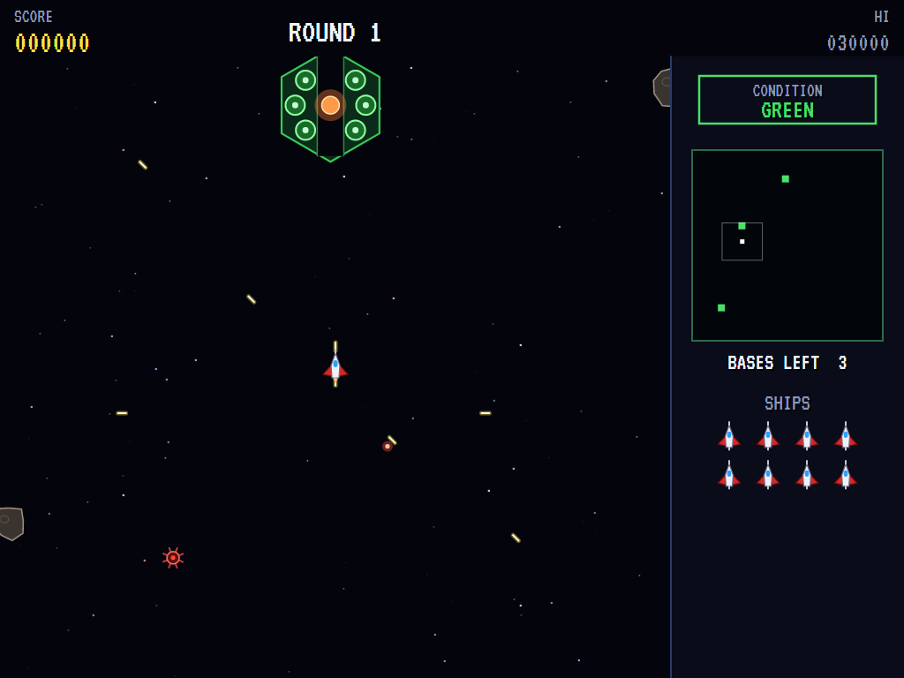
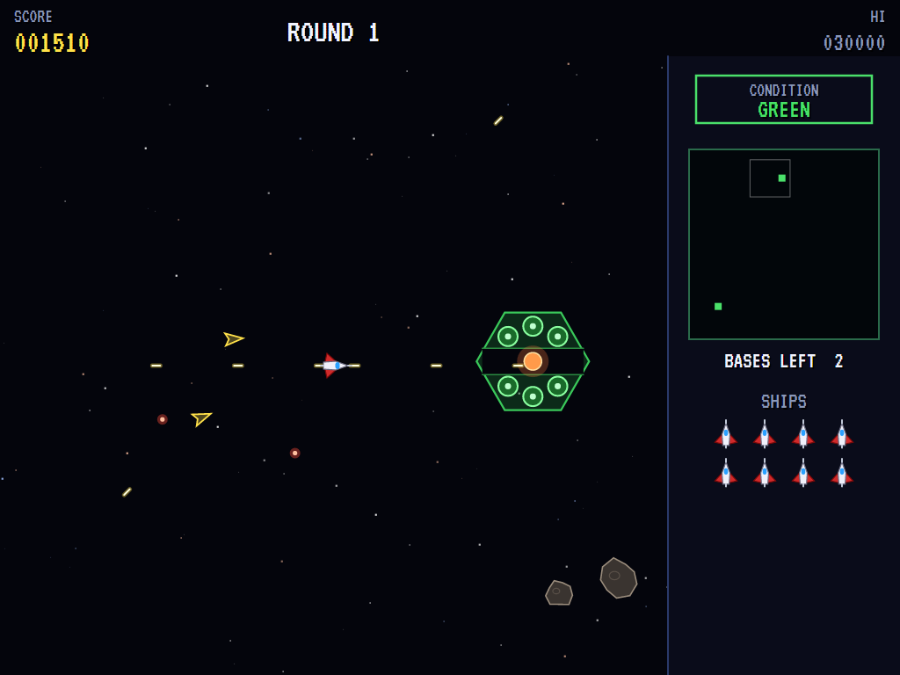
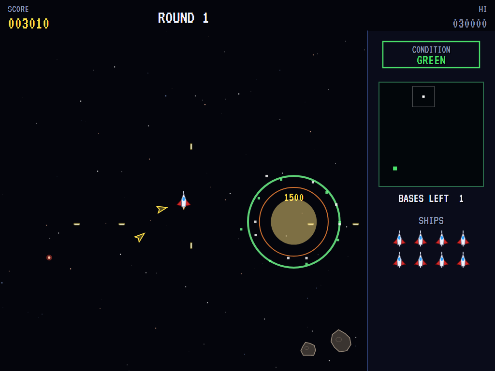
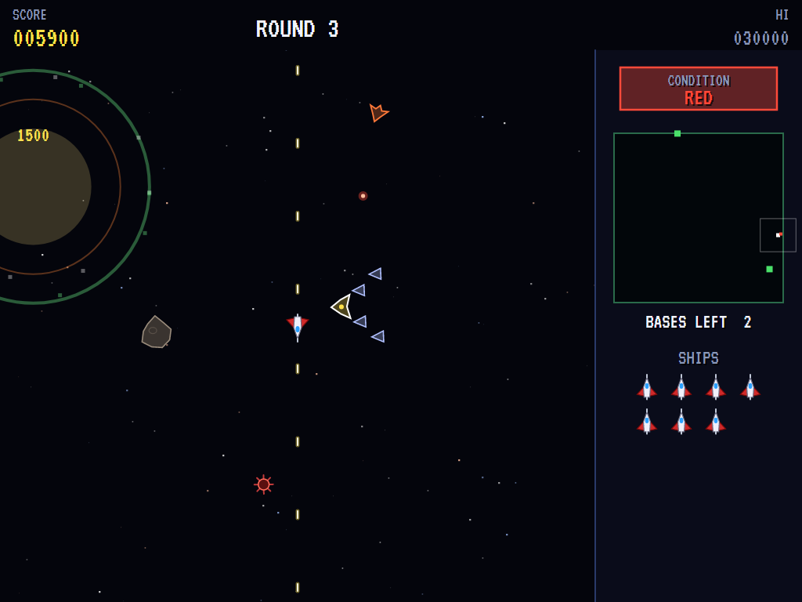
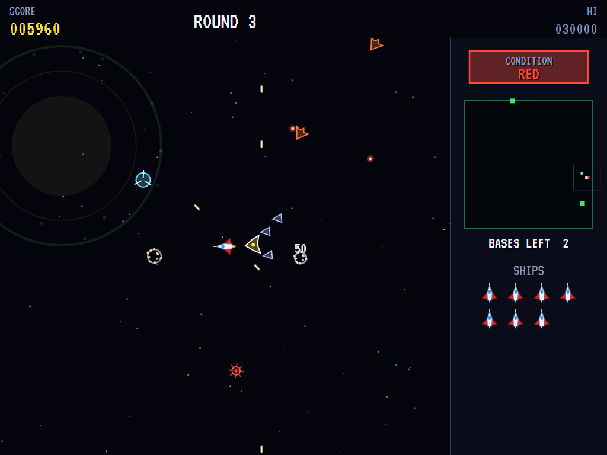
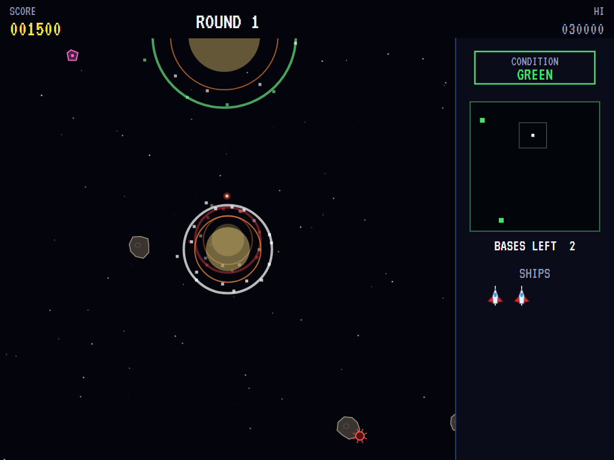
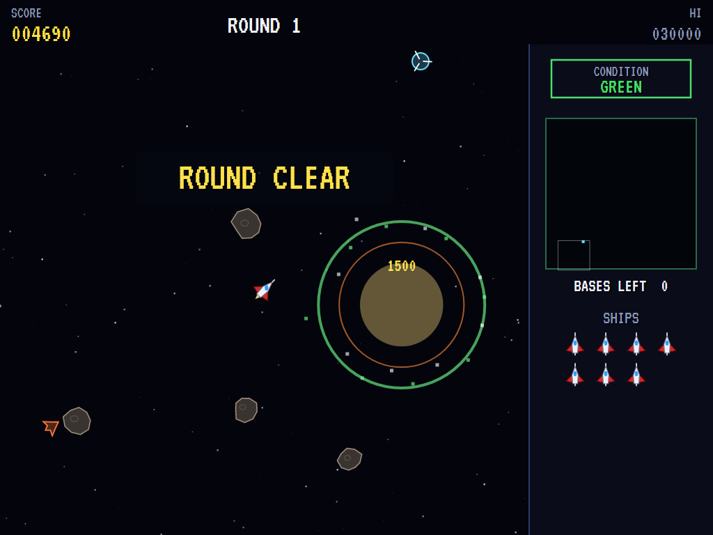
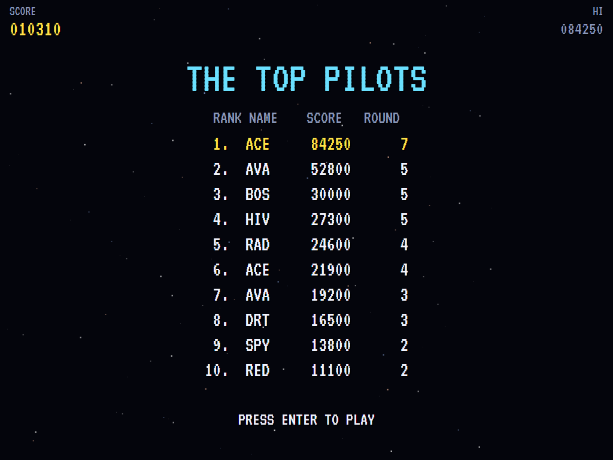

# AVA Bosconian

[](https://github.com/Harlock123/AVABosconian/actions/workflows/build.yml)

A free-flying space shooter in the style of Namco's 1981 arcade game **Bosconian**, built with .NET 10 and
Avalonia UI. Your fighter roams an open stretch of space that wraps round at its edges, guns firing fore
and aft at once. Hunt down every enemy base on the radar, shooting out its six gun pods or putting a shot
straight down its opening into the core. Meanwhile fighters, asteroids and mines close in, and the alert
climbs from green to red.

## Features

- **The ship**:
  - **Flying:** it never stops. It turns a step at a time towards whichever of the eight ways the stick points.
  - **Firing:** each shot goes out ahead and astern at the same time, so anything chasing you gets it too.
- **The bases**: each has a hexagonal frame with six gun pods round a glowing core.
  - **Bringing one down:** shoot out all six pods, or line up on the opening that runs through it and fire straight down it into the core. That brings the whole base down in one shot.
  - **Fighting back:** the pods fire on a ship that comes near, and the bases send fighters out.
  - **The round:** it ends when every base is gone. Later rounds have more.
- **The enemies**:
  - **Fighters:** quick Darts, nimble Wasps and Raiders that shoot.
  - **The spy ship:** it flies past now and then. Shoot it down for 800. If it gets clear away, the alert goes straight to **condition red** and a squadron comes for you.
  - **Squadrons:** a Leader with four wingmen in a V. Shoot the Leader while its wingmen still fly with it for 500, plus 250 for each wingman. Then the wingmen break off and attack on their own.
- **Asteroids and mines** drift about.
  - **Asteroids:** shoot one for 10.
  - **Mines:** shoot one for 20, and its blast takes out any fighters near it.
  - **Fighters too:** they get caught on asteroids and mines as well.
- **The alert**: it goes from green to yellow to red the longer a round goes on, and more fighters come the higher it is.
- **The radar**: shows the whole of space, with every base, the ship, your view, and any spy ship or squadron leader.
- **Scoring**: pods 100, bases 1,500, Darts 50, Wasps 60, Raiders 70, wingmen 50. An extra ship comes at 20,000 and every 60,000 after that.
- **Sound**:
  - **Music and alarms:** a pulsing engine drone in flight, the alert's siren, and a new title tune.
  - **The effects:** twin guns, pods and bases going up, fighters, asteroids and mines, the spy ship and its escape, and squadron alarms.
  - All of it is synthesised and mixed by OpenAL.
- **Attract mode**: leave the title alone for 15 seconds and a computer pilot plays.
  - **Choosing a heading:** it weighs up each of the eight ways it could go: where each takes it, and how soon it would meet an asteroid, a mine, a base, a fighter or a shot along it.
  - **Attacking a base:** it heads out to the line of the nearest base's opening, makes a straight run down it with its guns firing at the core, and veers off at the last moment.
  - **Spy ships:** it goes after one first whenever it sees one.
- **A top-ten high-score table** with arcade-style initials entry. It records the round reached.
- **Gamepads** through SDL2, as well as the keyboard.
- **Any window size**: the screen scales to fit, letterboxed. **Ctrl+S** saves a screenshot.
- **One self-contained executable** per platform: Windows, macOS and Linux on Intel/AMD and ARM.

## Screenshots

| The title | Round 1 | On patrol |
|:---------:|:-------:|:---------:|
|  |  |  |
| What everything is worth. | Blast off. | A base, and fighters coming. |

| The attack run | A base down | Condition red |
|:--------------:|:-----------:|:-------------:|
|  |  |  |
| Straight down the opening. | 1,500. | A squadron, and its leader. |

| The spy ship | Lost | Round clear |
|:------------:|:----:|:-----------:|
|  |  |  |
| Don't let it get away. | A mine. | Every base gone. |

| The top pilots | | |
|:--------------:|:-:|:-:|
|  | | |
| The high-score table. | | |

The screenshots are made by the tests, which play the game in a real (headless) window; see
[Tests](#tests).

## Download and run

Ready-to-run builds for Windows, macOS and Linux, on both Intel/AMD and ARM, are on the
[Releases page](https://github.com/Harlock123/AVABosconian/releases/tag/latest). **Latest build** is rebuilt
on every push to `main`. Each download is one self-contained executable: no .NET install is needed.

| Platform | Archive |
|---|---|
| Windows | `AVABosconian-win-x64.zip`, `AVABosconian-win-x86.zip`, `AVABosconian-win-arm64.zip` |
| macOS | `AVABosconian-osx-arm64.tar.gz` (Apple silicon), `AVABosconian-osx-x64.tar.gz` (Intel) |
| Linux | `AVABosconian-linux-x64.tar.gz`, `AVABosconian-linux-arm64.tar.gz`, `AVABosconian-linux-arm.tar.gz` |

```bash
tar -xzf AVABosconian-linux-x64.tar.gz     # or linux-arm64, linux-arm, osx-arm64, osx-x64
./AVABosconian
```

On Windows, unzip and run `AVABosconian.exe`. On macOS, if Gatekeeper refuses to open it, run
`xattr -d com.apple.quarantine AVABosconian` once. Run with `--no-audio` for silence.

**Sound** comes through OpenAL Soft, built in for every platform. In a virtual machine the game
detects it and uses a larger audio buffer, so the sound doesn't break up.

**Gamepads** use SDL2, which is bundled for Windows, macOS and Intel/AMD Linux. ARM Linux builds need it
installed; without it the keyboard still works:

```bash
sudo apt install libsdl2-dev            # Debian / Ubuntu / Raspberry Pi OS
sudo pacman -S --needed sdl2-compat     # Arch / Omarchy
```

## Controls

| Input | Action |
|-------|--------|
| **Enter** | Start |
| **Arrow keys** / **W A S D** (two at once for the diagonals), or the numeric keypad | Steer: the ship turns towards the way you point |
| **Space** / **Z** / **X** / **Ctrl** | Fire, ahead and astern (hold to keep firing) |
| **P** / **Esc** | Pause (Esc again to quit) |
| **M** | Mute |
| **Ctrl+S** / **Cmd+S** | Save a screenshot to the Pictures folder |

**Gamepad**: left stick or D-pad to steer, **A**, **B** or **X** to fire, **Start** to start and pause,
**Back** (while paused) to quit.

**Entering initials**: type letters, or dial with **Up**/**Down** and accept with **Space**; **Left** /
**Backspace** go back; **Enter** finishes.

## Tests

```bash
dotnet test AVABosconian.slnx
```

The engine has no UI and runs in fixed 60 Hz steps, so it plays the same at any frame rate, and a seed
always plays the same game. The tests check:

- **Space:** each round's bases spread out and away from the ship, with asteroids and mines between, and more bases as the rounds go on
- **The ship:**
  - never stopping, turning a step at a time, and space wrapping round
  - firing ahead and astern, and the shots fading out
- **The bases:**
  - pods for 100
  - the frame stopping shots that miss the opening
  - all six pods, or one shot down the opening into the core, bringing a base down
  - pods firing and bases sending out fighters
- **The enemies:**
  - fighters homing in and being shot down
  - asteroids and mines, and a mine's blast taking fighters with it
  - asteroids, mines, fighters and bases ending the ship
  - the spy ship shot down, or getting away and bringing condition red and a squadron
  - a leader shot with its wingmen still on it, and the wingmen breaking off
- **The round:** the alert rising, the next ship launching where the last was lost, the last ship ending the game, the round clearing and the next having more bases
- **The machine:** extra ships, the computer pilot clearing the first rounds, the attract cycle, the same game from the same seed, initials and the high-score file

The screenshot tests draw the real screen in a headless window. To refresh the README's pictures:

```bash
BOSCO_SHOTS=$PWD/Images dotnet test tests/AVABosconian.Tests --filter ScreenshotTests
```

To see how the computer pilot gets on, round by round (for tuning):

```bash
BOSCO_PROBE=1 dotnet test tests/AVABosconian.Tests --filter PilotProbe --logger "console;verbosity=detailed"
```

## Building

```bash
dotnet build AVABosconian.slnx
dotnet run --project src/AVABosconian
```

Needs the .NET 10 SDK. The sounds are made by `tools/make_sounds.py` (standard-library Python):
`python3 tools/make_sounds.py` rewrites `src/AVABosconian/Sounds`.

## Project structure

```
AVABosconian/
├── AVABosconian.slnx
├── src/AVABosconian/
│   ├── Engine/
│   │   ├── GameEngine.cs        # States, the title and demo cycle, and the engines' drone
│   │   ├── GameEngine.Play.cs   # The ship and its guns, the bases, fighters, spies and squadrons,
│   │   │                        # asteroids and mines, the alert, rounds and scoring
│   │   ├── ShipPilot.cs         # The computer pilot, for the demonstration (and the tests)
│   │   ├── Entities.cs          # Wrapping space, the eight headings, the ship, bases and their pods
│   │   ├── HighScoreTable.cs, InitialsEntry.cs
│   │   ├── InputHandler.cs, ControllerManager.cs  # Keys and an SDL2 gamepad
│   │   └── SoundManager.cs      # Effects and the tunes through OpenAL
│   ├── Audio/                   # The OpenAL engine (from the author's AVABand)
│   ├── Views/                   # The starfield, bases, ships and fighters, the radar panel, the screens
│   └── Sounds/                  # The synthesised effects and tunes
├── tests/AVABosconian.Tests/    # Gameplay, screenshot and probe tests
├── tools/make_sounds.py
└── Images/                      # Screenshots
```

## About and licence

AVA Bosconian © 2026 Lonnie Watson, under the [MIT License](LICENSE).

*Bosconian* © 1981 Namco (now Bandai Namco); the name belongs to its current owner. AVA Bosconian is an
independent, unofficial game in its style. Its ship, bases, Darts, Wasps, Raiders, spy ships and
squadrons, graphics, sounds, tunes and code are its own; nothing is taken from the arcade machine's
program, graphics, sound or music. It is not affiliated with or endorsed by any rights holder.
